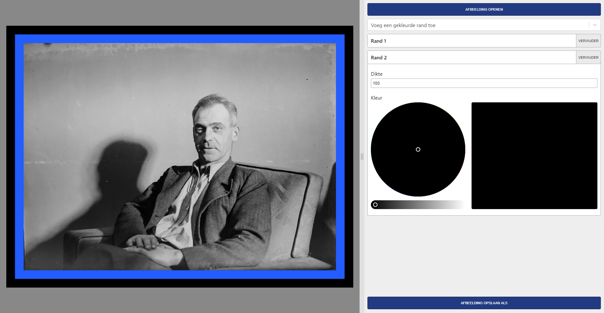

# Grandshop

An image editing program that is really easy to use.

Current features:
* Add colored borders
* Add a decorative image border
* Change the brightness and contrast
* Add a sepia effect
* Make an image black and white
* Resize an image
* Add colored text to the image
* Crop
* Rotate by any angle
* Mirror horizontally or vertically

Download: https://gitlab.com/bertyhell/grandshop/-/releases



## Developer docs

Grandshop is a native app written in [Rust](https://www.rust-lang.org) with the
[Slint](https://slint.dev) UI toolkit:

| Path | What |
| --- | --- |
| `ui/` | The Slint UI: views, components and the controls for each modification |
| `src/pipeline/` | The image modifications |
| `src/worker.rs` | Background rendering of the preview, with a cache per modification |
| `src/controller.rs` | Connects the UI to the image code: cards, open/save, zoom detail |
| `translations/` | Translations as gettext `.po` files |
| `assets/` | Bundled font, decorative borders and the app icon |
| `tests/golden/` | Reference images from the earlier Electron/sharp version |

While editing, the modifications run on a copy of at most 2560 px, so sliders react
immediately. Saving runs them on the full resolution image, and zooming in shows the
visible part at full resolution.

### Run the program from the repository

Install Rust with [rustup](https://rustup.rs). On Linux, also install:

```bash
sudo apt install libfontconfig1-dev libxkbcommon-dev
```

Then:

```bash
./run.sh
```

`./run.sh photo.jpg` opens a photo right away. `./build.sh` only builds the program, into
`target/release/grandshop`.

### Tests

```bash
cargo test
```

The golden tests compare every modification with the output of the earlier sharp based
version; `tests/golden/params.json` lists the exact parameters.

### Translations

UI texts are marked with `@tr("English text")` in the `.slint` files. The Dutch texts are in
`translations/nl/LC_MESSAGES/grandshop.po`, which POEditor can import and export. To check
that every text is translated:

```bash
python3 -I scripts/check-translations.py
```

To add a language, add `translations/<code>/LC_MESSAGES/grandshop.po` and an entry in
`LANGUAGES` in `src/settings.rs`.

## Build a new release

Install the packaging tool once:

```bash
cargo install cargo-packager --locked
```

Then, on each operating system:

```bash
./build.sh --package
```

The installers end up in `target/packages`: an NSIS setup `.exe` on Windows,
an `.app` and `.dmg` on macOS, and a `.deb` and AppImage on Linux.
