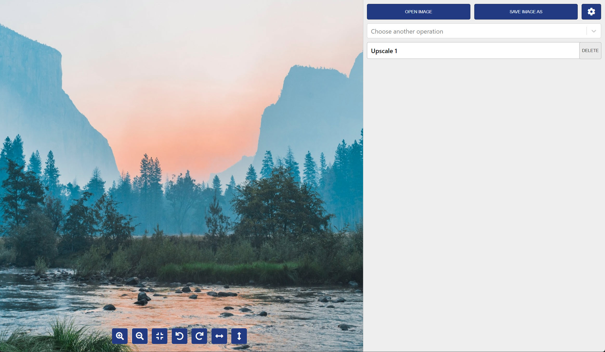
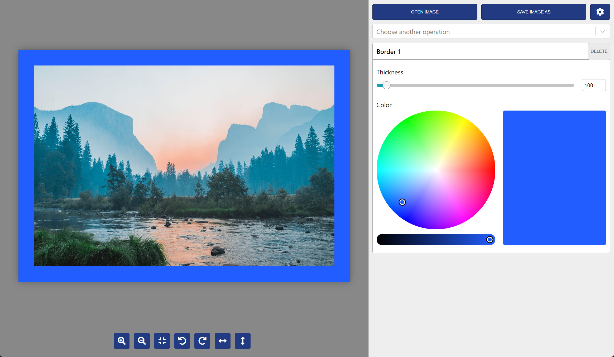
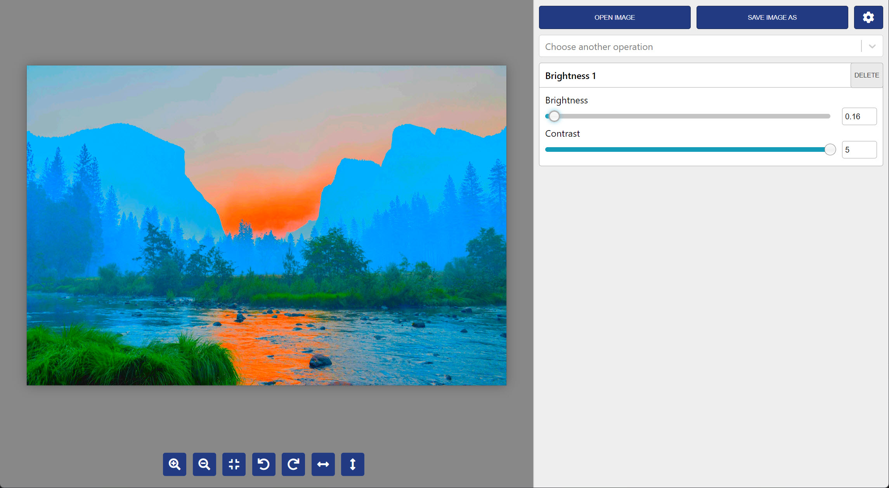
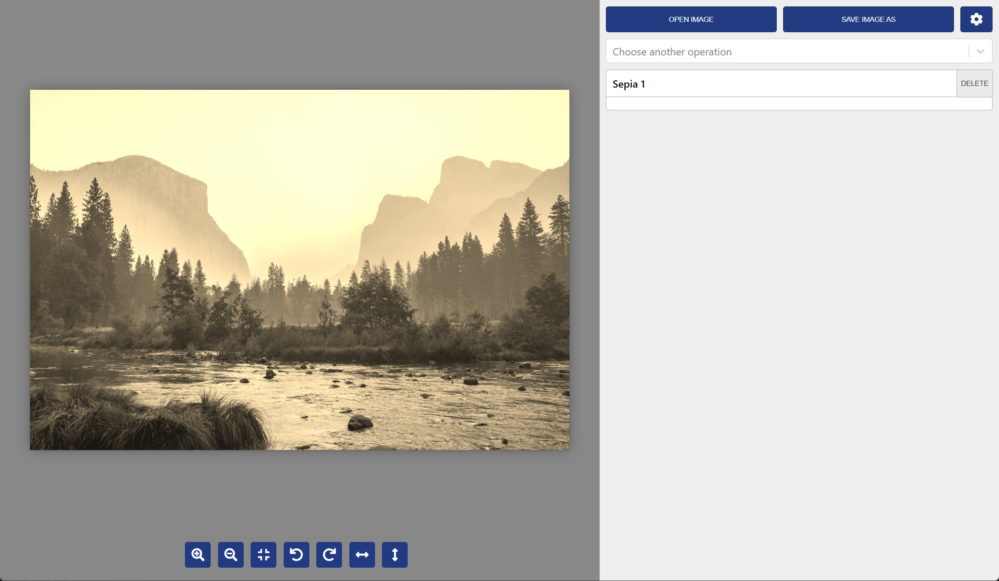
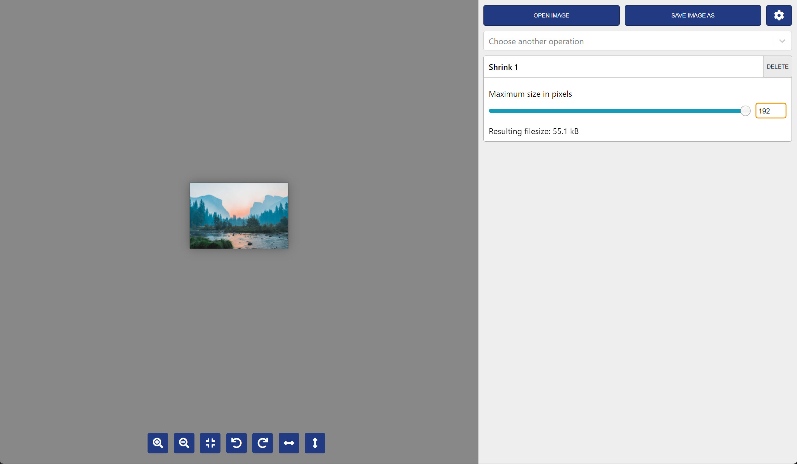
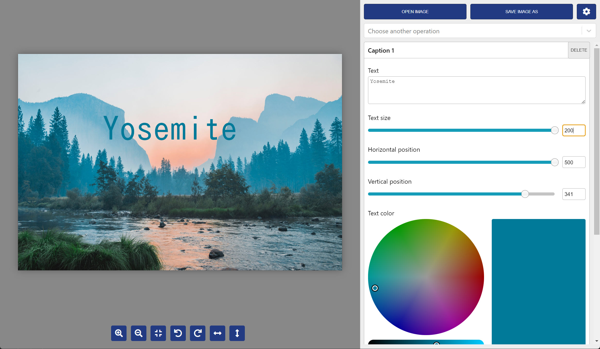
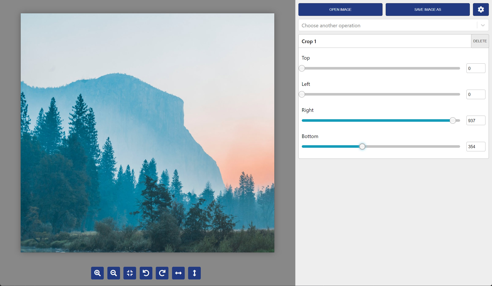
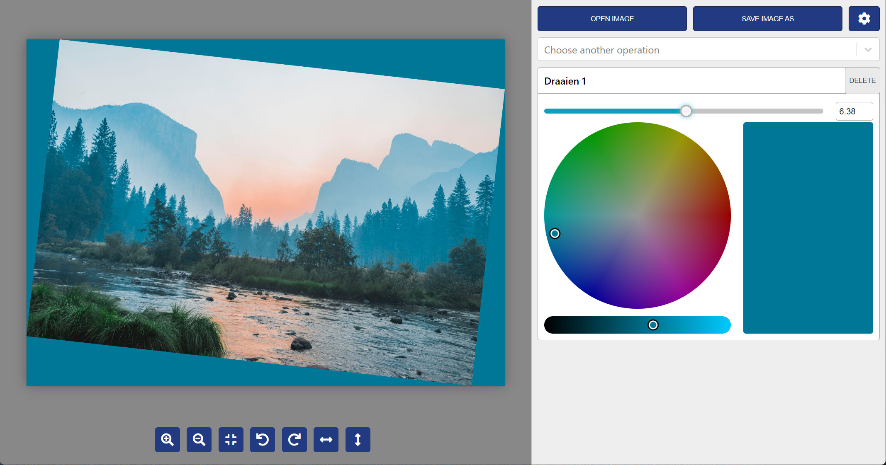
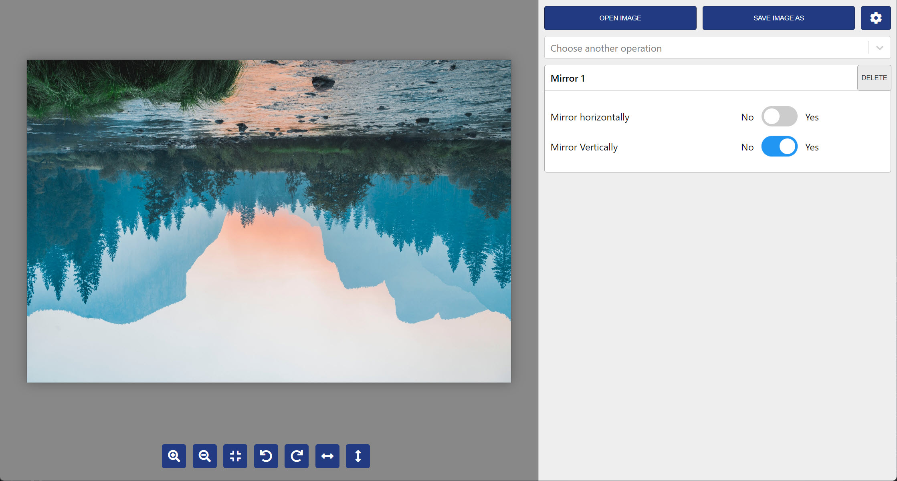

# Grandshop

A image editing program that is really easy to use.

Current features:

- Upscale images (4x)
  
- Add colored borders
  
- Change the brightness
  
- Add a sepia effect
  
- Resize an image
  
- Add colored text
  
- Crop
  
- Rotate
  
- Mirror
  

Download: https://gitlab.com/bertyhell/grandshop/-/releases

## Developer docs

### Run the program from the repository:

Install node v22.12 or newer.

On Windows, `@tensorflow/tfjs-node` is compiled from source during install, so you need the Visual Studio C++ build tools and Python 3.
If you have an old `msvs_version` or `python` setting in your global `.npmrc`, override it:

```bash
npm install --msvs_version=2022
```

Run the app in development mode with hot reloading:

```bash
npm run dev
```

Other useful commands:

```bash
npm run typecheck
npm run lint
npm run format
```

## Build a new release

```bash
npm run build:win
```

The installer is written to the `dist` folder.
